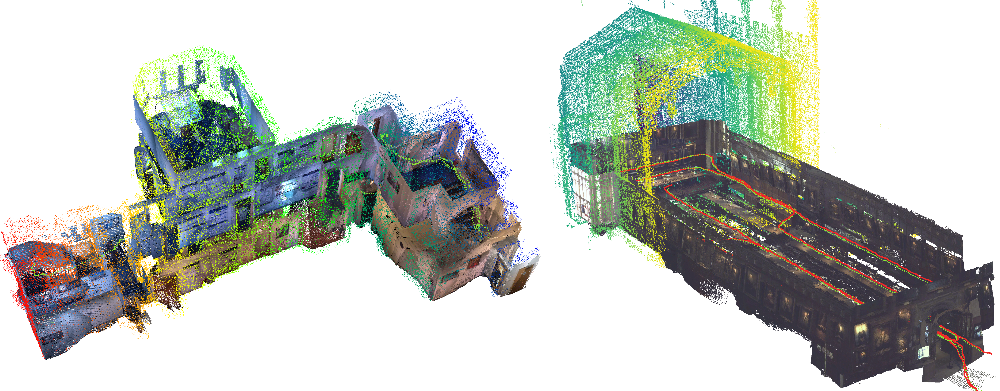
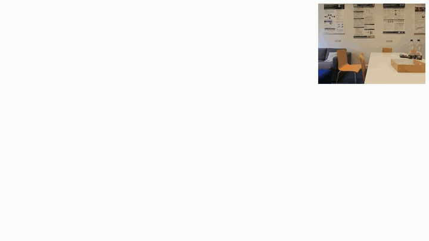
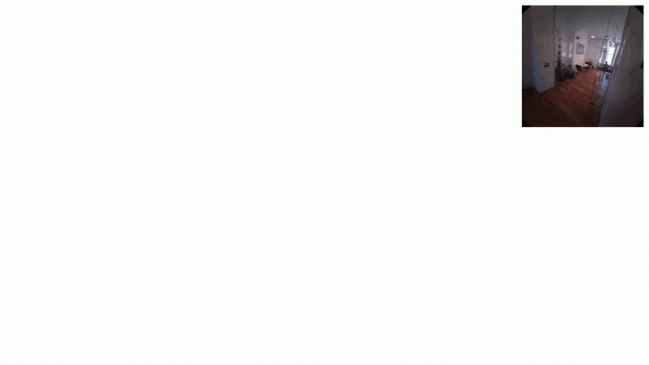
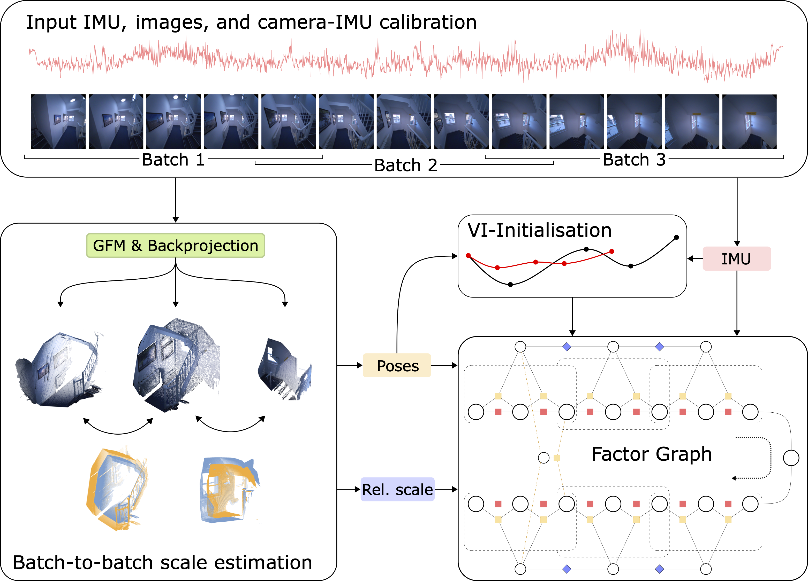

<div align="center">
  <h1>FoundationVIO: Enforcing Metric Scale in Feed-forward Visual-Inertial Odometry</h1>
  <p>
    <a href="https://jinrhee.github.io" target="_blank">Jin Rhee</a><sup>1</sup>,
    <a href="https://yuhaozhang7.github.io" target="_blank">Yuhao Zhang</a><sup>1</sup>,
    <a href="https://scholar.google.com/citations?user=ZxXBaswAAAAJ&hl=en&oi=ao" target="_blank">Frank Dellaert</a><sup>2</sup>,
    <a href="https://scholar.google.com/citations?user=BqV8LaoAAAAJ&hl=en&oi=ao" target="_blank">Maurice Fallon</a><sup>1</sup><br>
    <sup>1</sup>Dynamic Robot Systems Group, University of Oxford &nbsp;&nbsp;
    <sup>2</sup>Georgia Institute of Technology
  </p>

  [](https://arxiv.org/abs/2610.14951)
  [](https://www.youtube.com/watch?v=ieIHefwwKxk)
  [](https://dynamic.robots.ox.ac.uk/projects/foundation-vio/)
  [](https://drive.google.com/drive/folders/1rCsp7LJC4cZLmOc-oA1-pth2IbJh3rSC)

  
</div>

FoundationVIO is a visual-inertial odometry method that fuses inertial sensing with learned geometry from general feed-forward 3D geometric foundation models (GFMs) in a factor-graph based optimisation. Due to its use of a GFM and inertial sensing, FoundationVIO is able to 1) remain robust in low-texture sequences that are challenging for classical methods and 2) enforce metric scale in odometry estimates and reconstructions.

We additionally add GFM-based initialisation and loop-closure to demonstrate globally accurate trajectories and reconstruction. The method is compatible with general N-view GFMs such as DepthAnything3 and VGGT-Omega and naturally profits from advances in model accuracy and speed.

## Preview

<div align="center">
  
  
  <br>
  
  
</div>

We use a simple factor graph formulation to optimise for per-frame poses and per-batch scale. The input consists of IMU measurements, model predicted poses, and relative scale between batches of predicted geometry.

<div align="center">
    
</div>

## Setup

The method is tested using CUDA 12.8 with > 12GB of VRAM.

```
git submodule update --init --recursive
curl -fsSL https://pixi.sh/install.sh | bash
source ~/.bashrc
pixi install
```

Model weights (DA3, DINOv2, SALAD) download on the first run. Packages are in `pixi.toml`.

## Examples
### Project Aria

The script downloads [BigRoom3](https://drive.google.com/file/d/1-usS7bHyYeHCrmCNKW0Qufa9WwKUESJo/view) into `data/aria`, runs the full sequence, and evaluates it.

```
pixi run example-aria       # or: pixi run example-aria <dataset_dir>
```
See [Aria Office dataset](https://drive.google.com/drive/folders/1rCsp7LJC4cZLmOc-oA1-pth2IbJh3rSC) for more sequences. To run manually, unzip one into `data/aria`, then:

```
pixi run python -m foundation_vio.run --config configs/aria.yaml --sequence <name>
```

### ScaRF-SLAM

The `r05` sequence from the [ScaRF-SLAM](https://drive.google.com/drive/folders/1yYc3ctsetFZquQLp0JlV6gAeFr_35No8) dataset is a short sequence to quickly test. Use the script to download, extract, undistort, and run the full sequence.

```
pixi run example-scarf      # or: pixi run example-scarf <dataset_dir>
```

### Oxford Spires
The script below downloads and runs the `chch03` sequence from the [Oxford Spires](https://huggingface.co/datasets/ori-drs/oxford_spires_dataset) dataset.

```
pixi run example-spires     # or: pixi run example-spires <dataset_dir>
```

### Evaluating results

A run writes one trajectory, `tum_poses.csv`: SLAM with loop closures (the default), or odometry with `--set loop_closure.enabled=False`. The example scripts evaluate their run. To evaluate any run, `evaluate.py` prints the trajectory's ATE [m] and RPE over 1 m segments [m/m] against the dataset's ground truth:

```
# Aria: ground truth in the IMU frame
pixi run python scripts/evaluate.py <run_dir> data/aria/<name>_sequence/gt_poses_in_right_imu_frame_tum.txt --gt-frame imu
# ScaRF-SLAM: camera frame, extrinsics from the Kalibr camchain
pixi run python scripts/evaluate.py <run_dir> data/scarf/<seq>/<seq>_gt/poses_gt.txt --calib data/scarf/config/kalibr_imucam_chain.yaml
# Oxford Spires: base frame, extrinsics from the sensor yaml
pixi run python scripts/evaluate.py <run_dir> data/oxford-spires/<sequence>/processed/trajectory/gt-tum.txt --calib data/oxford-spires/<sequence>/sensor_pinhole_f700.yaml --gt-frame base
```

For a custom dataset, use `--gt-frame imu` for IMU-frame ground truth, or `--calib <camchain> --cam-key <key>` for camera-frame ground truth.

### Viewing results

```
pixi run view <run_dir>    # single reconstruction
pixi run replay <run_dir>  # iteratively builds reconstruction
```

`view` shows the map and trajectory (orange); `replay` plays the run back as if live.


```
pixi run python -m foundation_vio.run --config configs/aria.yaml --sequence BigRoom3 --view
```
Adding the `--view` flag opens a live Rerun window during the run. This can be slow due to GPU sharing and is not recommended. Prefer `view` / `replay` after the run.

## Custom dataset

The default loader (`sequence.dataset_type: 'default'`) reads one folder per sequence:

```
<dataset_dir>/<sequence>/
  images/                     undistorted pinhole images named image_<s>_<ns>.jpg or <s>.<ns>.png
  imu.csv                     header row, then time [ns], gyro x,y,z [rad/s], accel x,y,z [m/s^2]
  intrinsics.yaml             pinhole_intrinsics: [fu, fv, pu, pv]
  kalibr_imucam_chain.yaml    Kalibr camchain: <camera_key>.T_cam_imu (and optional timeshift_cam_imu [s])
  kalibr_imu_chain.yaml       Kalibr IMU noise densities and random walks
```

Copy `configs/scarf.yaml`, set `files.*` (paths relative to `<dataset_dir>/<sequence>`) and `files.camera_key`, add a `sequences` entry, and set `sequence.img_stride` so the model sees about 5 Hz. Then:

```
pixi run python -m foundation_vio.run --config configs/<name>.yaml --sequence my_seq --set files.dataset_dir=<dataset_dir>
```

`pixi run python scripts/bag_to_folder.py <bag> --image-topic <topic> --imu-topic <topic>` writes images and IMU from a ROS 2 bag.

## Citation

```bibtex
@article{rhee2026foundationvio,
  title={{FoundationVIO}: Enforcing Metric Scale in Feed-forward Visual-Inertial Odometry},
  author={Rhee, Jin and Zhang, Yuhao and Dellaert, Frank and Fallon, Maurice},
  journal={arXiv preprint arXiv:2610.14951},
  year={2026}
}
```

## License

The FoundationVIO code is released under the [GNU GPL v3.0](LICENSE). To use it under other terms, for example in closed-source software, please contact the authors.

The default model weights carry their own, non-commercial licenses (Depth Anything 3 Giant/Large: CC BY-NC 4.0; VGGT-Omega: FAIR Noncommercial Research License), so commercial use also needs commercially licensed weights.

Third-party licenses:

- [Depth Anything 3](https://github.com/ByteDance-Seed/Depth-Anything-3) (`models/depth-anything-3`): Apache-2.0 code; Giant/Large weights CC BY-NC 4.0
- [VGGT-Omega](https://github.com/facebookresearch/vggt-omega) (`models/vggt-omega`): FAIR Noncommercial Research License
- [SALAD](https://github.com/serizba/salad) (vendored): GPL-3.0
- [MapAnything](https://github.com/facebookresearch/map-anything) depth-edge filter: Apache-2.0
- [ScaRF-SLAM](https://github.com/ori-drs/ScaRF-SLAM) intra-batch fusion ([arXiv:2606.00307](https://arxiv.org/abs/2606.00307))
- [VGGT-Long](https://github.com/DengKaiCQ/VGGT-Long) robust Sim(3) IRLS ([arXiv:2507.16443](https://arxiv.org/abs/2507.16443))
- [Oxford Spires](https://huggingface.co/datasets/ori-drs/oxford_spires_dataset): CC BY-NC-SA 4.0
